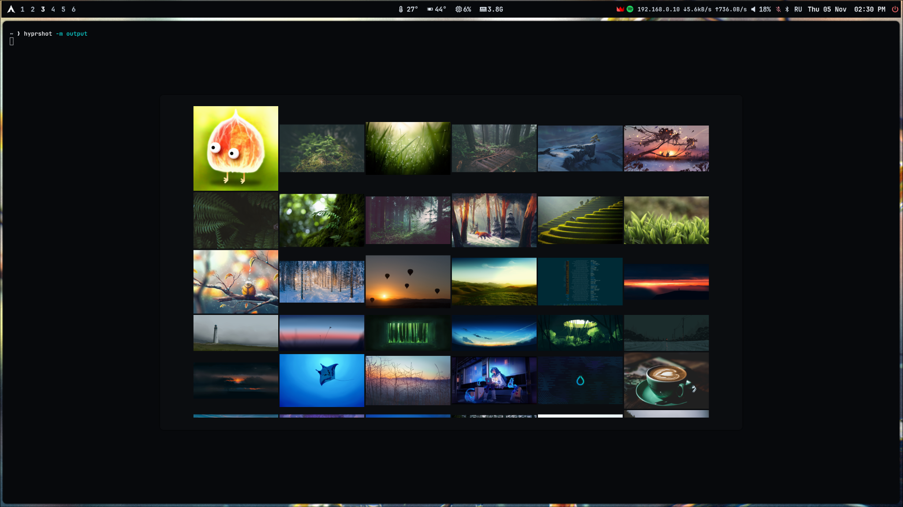

# Arch Linux + Hyprland Dotfiles

Настройки пользовательского Arch Linux / Hyprland (Lua), Waybar, Rofi,
Wlogout, Hyprlock, Hyprpaper, Waypaper, Kitty, Fish/Starship, GTK, Thunar,
Cava и кастомизированной темы SDDM.

> **Статус: предварительная версия для проверки.** Отражает только переданный
> архив от 5 ноября 2026 года; ещё не содержит сами обои и полный набор сторонних шрифтов/тем. GTK-тема
> Dracula-pink-accent и курсор Notwaita-Black из переданного архива добавлены.
> Списки пакетов и скриншот галереи Waypaper уже добавлены.
> Исходный компьютер не изменялся.

## Скриншот

Галерея Waypaper поверх Hyprland с настроенным Waybar (снимок от 5 ноября 2026 года).



На скриншоте присутствуют фрагменты сторонних обоев, которые не входят в репозиторий.

## Структура

- `home/.config/` — пользовательские конфиги; их содержимое соответствует `~/.config/`.
- `system/etc/sddm.conf.d/` — выбор темы входа SDDM.
- `system/usr/share/sddm/themes/` — тема SDDM и пользовательский `theme.conf.user`.
- `extras/unreferenced-scripts/` — скрипты из исходного архива, не вызываемые активными конфигами; не устанавливаются автоматически.
- `home/.local/share/themes/` и `home/.local/share/icons/` — переданные
  локальные GTK-тема и курсор с сохранёнными символическими ссылками.
- `assets/` — сведения об обоях и сторонних ресурсах.
- `screenshots/` — изображение галереи Waypaper с Waybar.
- `packages/` — точные списки явно установленных официальных и сторонних пакетов, а также пояснения к зависимостям.
- `LICENSES/` — лицензии сторонних компонентов и уведомления об авторстве.

## Установка вручную (без автоматического скрипта)

**Не запускайте эти команды без резервной копии своих настроек.** Сначала
сравните файлы в `home/.config/` со своими существующими конфигами.

Для безопасной пробы рекомендуется новая учётная запись или виртуальная
машина с установленными необходимыми пакетами. После проверки можно вручную
копировать выбранные каталоги из `home/.config/` в `~/.config/`, например:

```sh
mkdir -p ~/.config/waybar
cp -a home/.config/waybar/. ~/.config/waybar/
```

Пример затрагивает **только Waybar** и может заменить имеющиеся файлы в этом
каталоге; сначала сделайте их резервную копию.

SDDM является системным компонентом. Его конфиги и файлы темы хранятся в
`system/`; их копируют с правами администратора **только после проверки
темы и резервного копирования текущих файлов SDDM**. Для проверки исходной
темы и возможных отличий см. upstream:
https://github.com/stepanzubkov/where-is-my-sddm-theme

## Привязки к оборудованию и программам

- Конфигурация Hyprland — штатный `hyprland.lua` для современных релизов.
- Монитор настроен автоматически, но рабочие пространства 1–6 привязаны к
  `DP-1`; на другом компьютере нужно изменить эту привязку.
- Wlogout вызывается с координатами/размерами под 2560×1440;
  на других разрешениях расположение меню нужно скорректировать.
- Модуль GPU в Waybar вызывает `nvidia-smi`: он ориентирован на NVIDIA.
- Датчик CPU в опубликованной копии выбран по штатному имени `coretemp`,
  а не по абсолютному `/sys/devices/...` исходной системы; другой CPU может
  требовать настройки модуля.
- Waypaper использует `~/Pictures`, включая отсутствующий в архиве файл
  `wallhaven-n6y9zl.jpg`; без него оригинальные обои не восстановятся.
- Указаны `Materia-dark`, `Papirus-Dark`, `Notwaita-Black` и несколько
  Nerd Fonts. `Notwaita-Black` уже включён в сборку, остальные компоненты
  нужно установить отдельно. `Dracula-pink-accent` также включена, но
  исходные GTK-конфиги всё ещё выбирают `Materia-dark`.
- Активный лаунчер Rofi —
  `~/.config/rofi/launchers/type-4/style-8.rasi`, со своими импортами.
  `config.rasi` используется для запуска Rofi без `-no-config`, например
  для меню окон.
- В `extras/` есть устаревший `momo-power.sh`, который ссылается на
  отсутствующий `~/.config/waybar/scripts/session-menu.sh`; он не входит в
  установленную часть сборки.

## GTK-тема и курсор

Чтобы перенести **только** включённые GTK-тему и курсор на другой Linux,
сначала сравните существующие каталоги и сделайте их резервные копии.
После этого можно вручную скопировать данные из `home/.local/share/` в
`~/.local/share/` сохраняя символические ссылки (например, `cp -a`).
Никакая автоматическая установка в этом репозитории не выполняется.

## Лицензии и авторство

- **SDDM:** «Where is my SDDM theme?» — Степан Зубков,
  https://github.com/stepanzubkov/where-is-my-sddm-theme,
  MIT (`LICENSES/sddm-theme-MIT.txt`). Условия MIT также вложены в папку темы.
- **Rofi:** файлы `launchers/type-4/style-8.rasi` и `shared/*` основаны на
  `adi1090x/rofi`: https://github.com/adi1090x/rofi,
  GPL-3.0 (`LICENSES/rofi-adi1090x-GPL-3.0.txt`).
- **Cava:** часть шейдеров содержит собственные SPDX-уведомления и авторство;
  сохраняйте эти заголовки.
- **Dracula GTK:** Eliver Lara и участники, https://github.com/dracula/gtk,
  GPL-3.0 (`home/.local/share/themes/Dracula-pink-accent/LICENSE`).
- **Notwaita-Black:** проект ful1e5 и исходная работа GNOME Project;
  подробности и ссылки на лицензии: `LICENSES/notwaita-cursor-NOTICE.md`.
- **Иконки Wlogout:** PNG-иконки исключены из публичной копии из-за
  неподтверждённого авторства. Вместо них используется стандартное поле `text`
  из конфигурации Wlogout с подписями OFF / REBOOT / LOGOUT / LOCK. Команды
  кнопок и их клавиши не изменялись; внешний вид немного отличается от оригинала.
- Для собственных оставшихся конфигов лицензия ещё не выбрана. Нельзя
  автоматически считать сторонние файлы своей работой.

## Публикация на GitHub

Этот архив — **ещё не опубликованный репозиторий**. У владельца уже создан
пустой публичный репозиторий:
https://github.com/vampr5861-debug/arch-hyprland-dotfiles

Перед публикацией проверьте файлы, включая пользовательские скрипты и
системные конфиги SDDM, и следуйте `PUBLISH.md`. Установку целиком одним
скриптом репозиторий намеренно не предлагает. Не добавляйте сессии, токены,
пароли, истории команд и резервные копии.

**Важно о Wlogout:** картинки исключены из публичной копии; меню остаётся
с четырьмя текстовыми кнопками. На исходной машине ничего не менялось.
