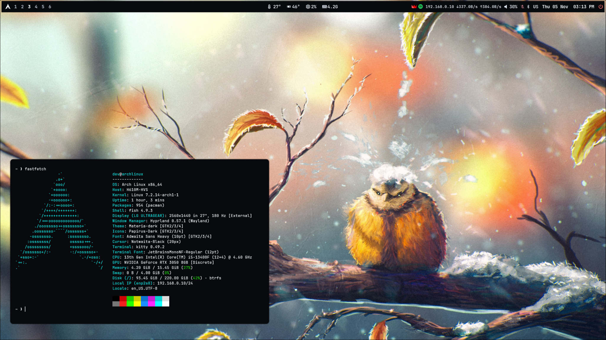
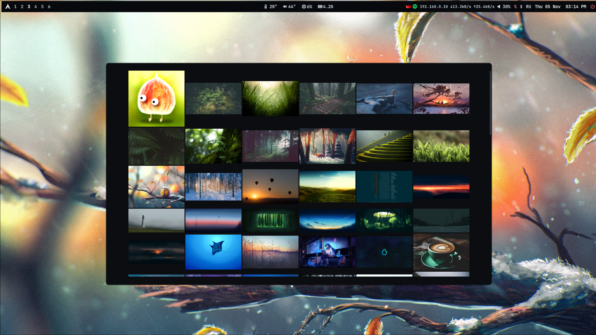
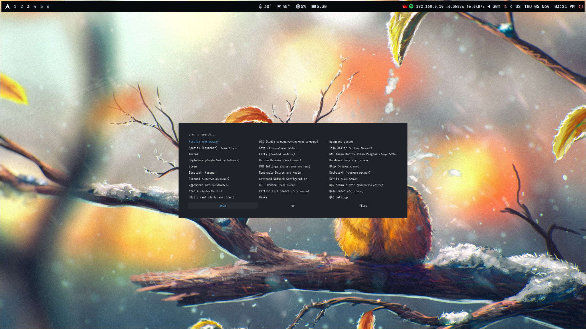

# MOMO · Hyprland Dotfiles

**Arch Linux / Hyprland · a personal dark desktop**

Минималистичный сетап с Waybar, Rofi, Waypaper, Hyprlock и SDDM.  
Чёткая типографика, аккуратные анимации, тёмные цвета и настройка без автоматических установщиков.

[Preview](#preview) · [Installation](#installation) · [Keybindings](#keybindings) · [Structure](#structure) · [Notes](#notes) · [Credits](#credits)

---

## Preview

### Desktop & Fastfetch

Arch Linux · Hyprland · Waybar · Kitty · Fastfetch

### Waypaper

Waypaper with Hyprpaper backend

### Rofi

Minimal three-column Rofi application launcher

> Эти изображения показывают настоящий рабочий стол. Сами обои, изображённые на скриншотах, не включены в репозиторий.

## Components

| Компонент | Что используется |
| :--- | :--- |
| **Window manager** | Hyprland, конфигурация на Lua, layout `dwindle` |
| **Bar** | Waybar: рабочие столы, CPU/GPU, память, сеть, звук, Bluetooth и часы |
| **Launcher** | Rofi — тема `type-4/style-8` |
| **Wallpaper** | Waypaper + Hyprpaper |
| **Lock screen** | Hyprlock — часы, дата, размытие фона |
| **Power menu** | Wlogout — компактные текстовые кнопки |
| **Login screen** | SDDM + `where_is_my_sddm_theme` |
| **Terminal / shell** | Kitty + Fish + Starship |
| **Files / GTK** | Thunar, GTK-темы, Papirus, курсор Notwaita-Black |
| **Extras** | SwayNC, Cava, Btop, Cliphist |

Особенности: 6 закреплённых рабочих столов, управление окнами с клавиатуры, scratchpad, анимации, переключение RU/EN через `Alt + Shift`.

## Installation

> [!WARNING]
> Это **снимок персонального окружения**, а не универсальный установщик Arch Linux. Проверяй пути и зависимости перед копированием. **Не копируй файлы поверх существующих настроек без резервной копии.** Все команды выполняются вручную.

### 1. Склонировать репозиторий

~~~bash
git clone https://github.com/vampr5861-debug/arch-hyprland-dotfiles.git
cd arch-hyprland-dotfiles
~~~

### 2. Установить основные пакеты

Для Arch Linux (официальные репозитории):

~~~bash
sudo pacman -S --needed git hyprland waybar rofi kitty thunar firefox \
  hyprlock hyprpaper hyprsunset hyprpolkitagent hyprshot \
  swaync cliphist wl-clipboard fish starship \
  pipewire pipewire-pulse wireplumber pavucontrol \
  nwg-look papirus-icon-theme materia-gtk-theme \
  ttf-jetbrains-mono-nerd otf-font-awesome \
  btop cava blueman qt6ct sddm \
  xdg-desktop-portal-hyprland xdg-desktop-portal-gtk
~~~

Дополнительно нужны `waypaper` и `wlogout` — на исходной машине они были сторонними пакетами. При наличии `yay`:

~~~bash
yay -S --needed waypaper wlogout
~~~

Списки **всех явно установленных** пакетов исходной системы находятся в [packages/](packages/). Не устанавливай их все подряд: там есть игры, браузеры и программы, не относящиеся к оформлению.

### 3. Сделать резервную копию и скопировать нужные конфиги

В репозитории пользовательские настройки лежат в `home/.config/`. Можно переносить **выборочно**, например только Waybar:

~~~bash
# Если Waybar уже настроен, сперва сохрани старую папку:
cp -a ~/.config/waybar ~/.config/waybar.backup

# Затем, находясь в корне клонированного репозитория:
mkdir -p ~/.config/waybar
cp -a home/.config/waybar/. ~/.config/waybar/
~~~

Если `~/.config/waybar` ещё нет, пропусти команду резервного копирования. Таким же образом можно перенести `hypr`, `rofi`, `kitty`, `waypaper`, `wlogout` и остальные папки из `home/.config/`.

Для отдельно упакованных темы и курсора:

~~~bash
mkdir -p ~/.local/share/themes ~/.local/share/icons
cp -a home/.local/share/themes/Dracula-pink-accent ~/.local/share/themes/
cp -a home/.local/share/icons/Notwaita-Black ~/.local/share/icons/
~~~

Перед копированием убедись, что одноимённых папок с твоими настройками нет, или сохрани их отдельно.

### 4. SDDM — только при необходимости

Тема входа относится к **системным** файлам. Перед её заменой сделай резервную копию своего SDDM и проверь содержимое:

- `system/usr/share/sddm/themes/where_is_my_sddm_theme/` — файлы темы и `theme.conf.user`.
- `system/etc/sddm.conf.d/99-where-is-my-sddm.conf` — выбор темы.

После проверки их можно вручную перенести в соответствующие `/usr/share/sddm/themes/` и `/etc/sddm.conf.d/` с правами администратора. Не включай/отключай display manager вслепую, особенно если уже используешь другой экран входа.

### 5. Подстроить под своё оборудование

В этом сетапе есть привязки к исходному компьютеру:

- **Монитор:** рабочие столы 1–6 привязаны к `DP-1` в [hyprland.lua](home/.config/hypr/hyprland.lua).
- **Разрешение:** параметры запуска Wlogout рассчитаны на 2560×1440.
- **Видеокарта:** датчик температуры в Waybar использует `nvidia-smi`; на AMD/Intel модуль нужно заменить или отключить.
- **Обои:** Waypaper ссылается на `~/Pictures/wallhaven-n6y9zl.jpg`. Сам файл не включён из-за неподтверждённых прав на распространение — выбери свои обои.
- **Шрифты:** могут понадобиться дополнительные Nerd Fonts, в том числе Iosevka для некоторых элементов Rofi.
- **GTK:** в текущих конфигурациях указан `Materia-dark`; `Dracula-pink-accent` также включена для ручного выбора.

После запуска Hyprland проверь конфигурацию:

~~~bash
hyprctl configerrors
~~~

> [!NOTE]
> Версия Hyprland должна поддерживать используемый формат `hyprland.lua`. Совместимость со всеми релизами и видеокартами не проверялась. Сетап предназначен для ручной адаптации, без сомнительных `curl | sh`-установщиков.

## Keybindings

**`Super` = клавиша Windows.** Все сочетания ниже взяты из опубликованного [hyprland.lua](home/.config/hypr/hyprland.lua).

### Программы и система

| Сочетание | Действие |
| :--- | :--- |
| <kbd>Super</kbd> + <kbd>Enter</kbd> | Kitty |
| <kbd>Super</kbd> + <kbd>E</kbd> | Thunar |
| <kbd>Super</kbd> + <kbd>B</kbd> | Firefox |
| <kbd>Super</kbd> + <kbd>Space</kbd> / <kbd>Super</kbd> + <kbd>R</kbd> | Rofi: запуск приложений |
| <kbd>Super</kbd> + <kbd>Shift</kbd> + <kbd>Space</kbd> | Rofi: переключение окон |
| <kbd>Super</kbd> + <kbd>W</kbd> | Waypaper |
| <kbd>Super</kbd> + <kbd>S</kbd> | Центр уведомлений SwayNC |
| <kbd>Super</kbd> + <kbd>Shift</kbd> + <kbd>N</kbd> | Скрыть уведомления |
| <kbd>Super</kbd> + <kbd>Shift</kbd> + <kbd>B</kbd> | Показать / скрыть Waybar |
| <kbd>Super</kbd> + <kbd>L</kbd> | Заблокировать экран (Hyprlock) |
| <kbd>Super</kbd> + <kbd>Esc</kbd> | Меню питания Wlogout |
| <kbd>Print</kbd> | Снимок монитора в буфер обмена |
| <kbd>Super</kbd> + <kbd>Shift</kbd> + <kbd>S</kbd> | Снимок области в буфер обмена |
| <kbd>Alt</kbd> + <kbd>Shift</kbd> | Переключить RU/EN |

### Окна и раскладка

| Сочетание | Действие |
| :--- | :--- |
| <kbd>Super</kbd> + <kbd>Q</kbd> | Закрыть окно |
| <kbd>Super</kbd> + <kbd>Ctrl</kbd> + <kbd>Q</kbd> | Принудительно завершить окно |
| <kbd>Super</kbd> + <kbd>V</kbd> | Переключить tiled / floating |
| <kbd>Super</kbd> + <kbd>F</kbd> | Полный экран |
| <kbd>Super</kbd> + <kbd>M</kbd> | Максимизация |
| <kbd>Super</kbd> + <kbd>P</kbd> | Pseudotile |
| <kbd>Super</kbd> + <kbd>Shift</kbd> + <kbd>P</kbd> | Закрепить плавающее окно |
| <kbd>Super</kbd> + <kbd>← ↑ ↓ →</kbd> | Переместить фокус |
| <kbd>Super</kbd> + <kbd>Shift</kbd> + <kbd>← ↑ ↓ →</kbd> | Переместить окно |
| <kbd>Super</kbd> + <kbd>Ctrl</kbd> + <kbd>← ↑ ↓ →</kbd> | Изменить размер окна |
| <kbd>Super</kbd> + <kbd>Alt</kbd> + <kbd>← ↑ ↓ →</kbd> | Поменять окна местами |
| <kbd>Super</kbd> + <kbd>Tab</kbd> | Перейти к следующему окну |
| <kbd>Super</kbd> + <kbd>Shift</kbd> + <kbd>T</kbd> | Swap split (dwindle) |
| <kbd>Super</kbd> + <kbd>ЛКМ</kbd> / <kbd>ПКМ</kbd> | Перетаскивать / изменять размер окна |

### Рабочие столы

| Сочетание | Действие |
| :--- | :--- |
| <kbd>Super</kbd> + <kbd>1–6</kbd> | Перейти на рабочий стол |
| <kbd>Super</kbd> + <kbd>Shift</kbd> + <kbd>1–6</kbd> | Отправить окно на рабочий стол |
| <kbd>Super</kbd> + <kbd>Колесо мыши</kbd> | Переключать рабочие столы |
| <kbd>Super</kbd> + <kbd>\`</kbd> | Показать / скрыть scratchpad |
| <kbd>Super</kbd> + <kbd>Shift</kbd> + <kbd>\`</kbd> | Отправить окно в scratchpad |
| <kbd>Super</kbd> + <kbd>G</kbd> | Группировка окон |

### Кнопки Wlogout

| Клавиша | Действие |
| :--- | :--- |
| <kbd>S</kbd> | Выключить |
| <kbd>R</kbd> | Перезагрузить |
| <kbd>E</kbd> | Выйти из сессии |
| <kbd>L</kbd> | Заблокировать |

Публикуемая конфигурация Wlogout использует **текстовые кнопки**: оригинальные PNG-иконки не включены из-за неизвестного происхождения.

## Structure

~~~text
arch-hyprland-dotfiles/
├── home/
│   ├── .config/            # Hyprland, Waybar, Rofi, Kitty и др.
│   └── .local/share/      # Dracula GTK, Notwaita cursor
├── system/                # SDDM config + theme
├── screenshots/           # Реальные скриншоты
├── assets/                # Примечания об обоях и ресурсах
├── packages/              # Списки пакетов исходной системы
├── extras/                # Неиспользуемые скрипты (не устанавливать)
├── LICENSES/              # Уведомления и лицензии
├── AUDIT.md               # Аудит исходных конфигов
└── README.md
~~~

## Notes

- В репозитории **нет автоматического установочного скрипта**. Все настройки копируются выборочно и вручную.
- Это копия конфигов на дату **5 ноября 2026 года**. Новые изменения живой системы не попадают сюда сами собой.
- На скриншотах показаны сторонние обои, но сами файлы этих обоев не распространяются.
- Системные и пользовательские пути, шрифты и драйверы могут потребовать настройки.
- `extras/unreferenced-scripts/` сохранены для истории; они **не входят в активную конфигурацию**.
- Перед публикацией собственных изменений не добавляйте секреты, токены, приватные ключи и данные приложений.

## Credits

Спасибо разработчикам и авторам оригинальных проектов:

- **[Hyprland](https://hypr.land/)**, **[Waybar](https://github.com/Alexays/Waybar)**, **[Rofi](https://github.com/davatorium/rofi)** и остальным open-source проектам.
- **[Where is my SDDM theme?](https://github.com/stepanzubkov/where-is-my-sddm-theme)** — Степан Зубков, MIT.
- **[adi1090x/rofi](https://github.com/adi1090x/rofi)** — элементы Rofi, GPL-3.0.
- **[Dracula GTK](https://github.com/dracula/gtk)** — Eliver Lara и участники, GPL-3.0.
- **[Notwaita Cursor](https://github.com/ful1e5/notwaita-cursor)** — см. [уведомление о лицензировании](LICENSES/notwaita-cursor-NOTICE.md).

Подробности о сторонних лицензиях находятся в [LICENSES/](LICENSES/) и каталогах соответствующих тем. **Общая лицензия на авторские конфиги пока не выбрана**.

---

**Made for Arch Linux + Hyprland**

[Back to top](#momo--hyprland-dotfiles)

